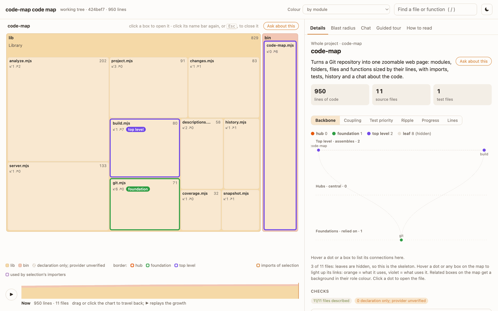
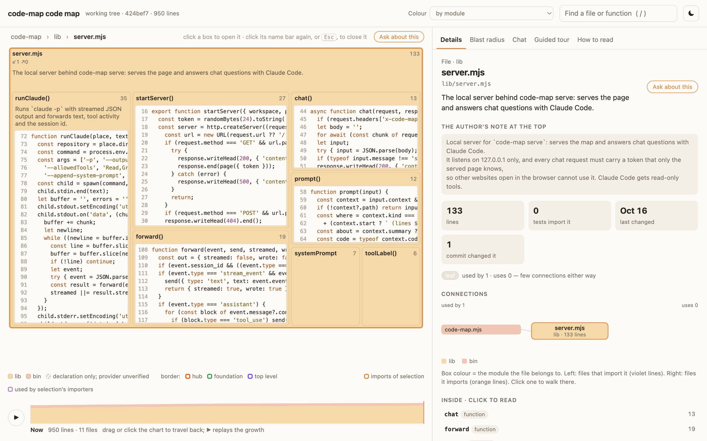
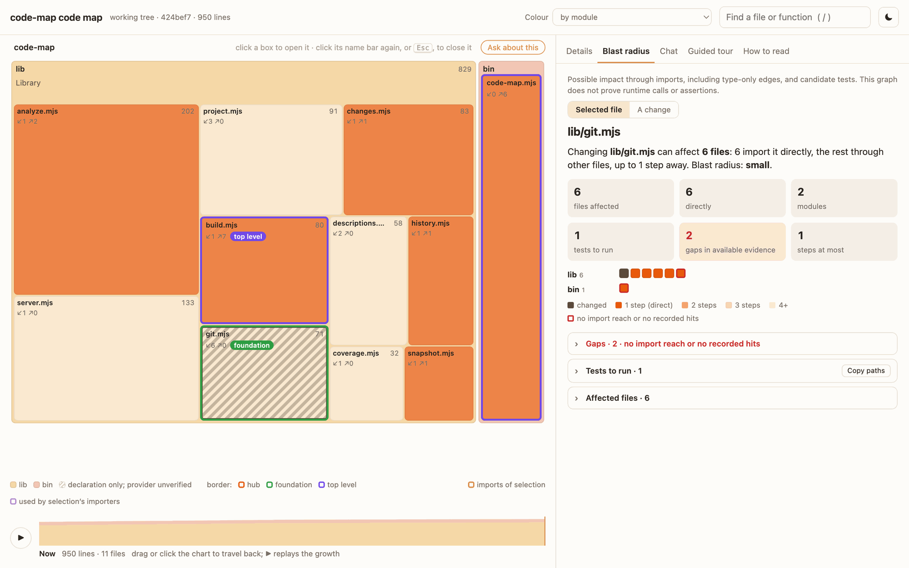

# code-map

**code-map turns a codebase into a picture you can zoom into, and lets you ask questions about it.**



*The map of code-map's own code. The screenshots in this README all come from this repository.*

It reads a project's code and builds one web page that works offline. You don't need to understand the code to use it. That's the point: it's built for learning a codebase.

Read [Python scanning](docs/python.md) for Python interpreters, imports, tests and limits.

Read [Electron security, entry points and platform code](docs/electron.md) for Electron checks.

Code-map does not rate the whole codebase. `code-map verify` rates one change with four ratings and a readiness state. Read [What Code-map rates, and what it does not](#what-code-map-rates-and-what-it-does-not).

## What it helps you do

### See the whole codebase at once

- **Zoom from the project down to one function.** Modules, folders, files and functions are boxes inside boxes. The area of each box is its number of lines, so you see at a glance where the weight of the project is.
- **Read the code in place.** A function's box shows its code, and each box shows a short plain-language description.
- **Find anything fast.** Press `/` to search for a file or a function. Click a name in the panel or in the path above the map to jump there.
- **Learn the code step by step.** When the project has a guided tour, it walks through how the project works and highlights the files at each stop.
- **Colour the map by what matters to you:** module, last change, description status, direct tests, coupling role, hotspot, blast radius, failure tests, or test coverage (with a coverage report).

### Understand how the parts connect

- **See what each file uses and what uses it.** The Details panel lists the imports in both directions. A Connections diagram lets you walk from file to file.
- **Find the central files first.** Each file gets a coupling role (hub, foundation, top level or leaf) from how many files it imports and how many files import it. The Backbone graph shows only the files that hold the project together.
- **Trace one name across the code.** "Used by" lists every file that imports a given function or type.
- **Find links that imports do not show.** "Changes together with" lists the files that change in the same commits, also when no import connects them.

For Electron projects, inspect [IPC contracts](docs/electron.md).

### Change code with more confidence

- **See what a change can break.** The Blast radius follows imports backwards from a file, from your recent commits, from your branch, or from your uncommitted work. It counts the affected files and how many steps away they are.
- **Know which tests to run.** The Blast radius lists the test files that reach the changed code. One click copies their paths for your test command.
- **Find the untested areas.** Gaps are changed or affected files that no test reaches. Test priority suggests which files need a test of their own.
- **Find the failures that no test checks.** The Tests tab counts your test cases and their layers, finds the places where each function reports a failure, and lists the functions that have no failure assertion for them. It gives statistics, what it sees with evidence, next steps, and the limits of the scan.
- **Check schema changes.** Use `code-map inspect --summary --base <ref>` to compare two schema snapshots. It reads Prisma, Drizzle, explicit SQLite and JSON Schema. It classifies each change as breaking, compatible or unknown, and it reports a schema change without a new migration. Refer to [schema compatibility](docs/retrieval.md#schema-compatibility). `verify` adds rollout leads. The restricted harness tests SQLite fixture migrations.
- **See which parts are self-contained.** The Ripple table shows how far a change to one module can spread into each other module.
- **See how the exported interface changed.** `code-map inspect --summary --base <ref>` lists removed, changed and added exports, and the files that still import each removed or changed export. Exports of package entry points are reported as public API. Refer to [compare the exported interface](docs/retrieval.md#compare-the-exported-interface).
- **Run the tests in isolation, when you allow it.** `code-map run` runs one command that you authorized in a sandbox. The run has no network, cannot read your credential folders, works on a private copy of the code, and has limits on time, memory and output. `code-map verify` can then use its test report. Refer to [run tests in the restricted worker](docs/run.md).

### Keep the codebase healthy

- **Get a list of code-health checks:** imports in a direction that your rules forbid, import cycles, exports that nobody uses, declarations with no matching implementation, hotspots (large files that change often), and files with zero recorded coverage hits. `code-map inspect --summary` also finds undeclared and unused packages and orphaned files. Refer to [package checks](docs/retrieval.md#package-checks).
- **Watch size limits and budgets.** Set a line limit for files and functions, and a line budget for each module. The map flags functions over the limit and shows each module's lines against its budget.
- **Track progress.** The Progress view shows, for each module, how many functions have an implementation and how many files tests import directly.
- **Check your dependencies.** `code-map inspect --summary` counts the packages of `package-lock.json`: install scripts, packages without an integrity value, packages from other hosts, and licenses. An optional `supplyChain` policy finds denied licenses and hosts. With `--base`, the summary shows the dependency change. The page does not show this. Refer to [dependencies and supply chain](docs/retrieval.md#dependencies-and-supply-chain).

### See how the code grew

- **Replay the history.** The strip at the bottom shows the code commit by commit. Drag it to see the code as it was, or press play to watch it grow. New files get an outline.

### Ask questions about the code

- **Chat about the box that you selected.** `code-map serve` adds a chat that uses your Claude Code login. Answers link to `path:line`, and a click moves the map there. The chat reads the same version of the code that the map shows, and it can only read.

### Fit it into your work

- **Map any version.** Map a branch, a commit, or your uncommitted work. By default, code-map follows the branch where the code changed most recently.
- **Share one file.** The page is a single HTML file. You can keep it, email it or open it later.
- **Let an assistant write the descriptions.** `code-map todo` lists the files without a description, ready to give to an assistant. The map marks a description as stale when the file's exports change.
- **Give AI agents the same facts.** Use `code-map inspect` for compact JSON containing dependencies, cycles, shared-type candidates, declaration metrics, export usage, candidate tests and the test-quality summary. Refer to [AI-AGENT-USE.md](AI-AGENT-USE.md).
- **Map TypeScript, JavaScript and Python projects.** TypeScript and JavaScript scans include Next.js-style aliases and `require(…)` imports. Refer to [Python scanning](docs/python.md) for Python imports and test discovery.

Verification also reports [measured coverage information](docs/coverage.md): project totals, mapped counters, coverage loss and unexecuted exports.

Map signals come from static analysis, Git history and optional working-folder coverage. Verification also accepts bound reports and authorized isolated runs. Static relationships show possible impact and candidate tests. They do not prove runtime behavior. [Section 4](#4-find-your-way-around-the-map) explains the limits of each signal.

| Open a file to read its functions and code | See what a change can break |
| --- | --- |
|  |  |

## What Code-map rates, and what it does not

Code-map gives two kinds of results. `code-map inspect --summary` gives leads about one snapshot of the whole codebase. `code-map verify` rates one change. No command rates the whole codebase, and no command gives one overall score or a percentage of correctness.

| | `code-map inspect --summary` | `code-map verify --request <file>` |
| --- | --- | --- |
| What it reads | One snapshot: a commit or the working tree | One change: from a base commit to a head commit or to the working tree |
| What it gives | Findings by rule, gaps, frameworks, tests and dependencies, with the commands for the next step | Four ratings, one readiness state, a Markdown report, a JSON result and an exit code |
| Ratings | None. The summary shows `verification.state: "NOT_RUN"` | Four independent ratings of the change |
| Project code that runs | None | None, unless the request enables execution with an authorization that you made |

A finding is a lead, not a defect. Read the source before you act on it.

### The four ratings

`verify` rates four categories of the change. Each category gets a value from 1 to 5 (1 Failing, 2 Weak, 3 Adequate, 4 Strong, 5 Thorough), or Unassessed, or Not applicable. Code-map never adds, averages or weights the four ratings.

| Category | What the checks ask | Minimum evidence for a rating | Level 3 needs, for example |
| --- | --- | --- | --- |
| Structural Integrity | Do the new imports resolve? Does the change add an import cycle or break an architecture rule? Are the types compatible? | Comparable base and head analyses, and a changed source file | Every required structural check passes. A TypeScript change needs a bound compiler report for the type check. Under `static-baseline-v0`, a feature stays at 2, because no check of that rule set can confirm consumer contracts |
| Verification Coverage | Did the tests of the change run on the head? Which part of the changed lines and branches ran? | A bound test report and a bound line-coverage report of the head | The changed test files ran, and at least 80% of the changed lines ran. Level 4 also needs 70% of the changed branches |
| Behavioral Confidence | Do the test results show the expected behavior, without new failures? | Under `evidence-v1`: an isolated test report of the head and an independent reference (an isolated base run, an isolated differential run, or a person's current oracle record for a case that ran). `static-baseline-v0` never rates this category | Every required behavioral check passes, and no test case fails that passed on the base |
| Change Completeness | Did the change stay inside its allowed paths, update its consumers, and keep its tests? | Allowed paths in the request, comparable analyses and the test cases of both snapshots | Every required completeness check passes, and no import with an unknown target can reach the changed files |

### Readiness

Readiness is one state for the whole change. It comes from the checks, not from the rating values.

| Readiness | Exit code | Meaning |
| --- | --- | --- |
| READY | 0 | Every required check passed and no review is open |
| REVIEW | 1 | Failures or reviews remain open |
| BLOCKED | 2 | A blocking check failed, for example a new architecture-rule break, a new focused test or a new test failure |
| INSUFFICIENT_EVIDENCE | 3 | Required evidence is missing. This result is not an approval and not a failure |

Exit code 4 means that the request is invalid or the command failed.

### Why a static run gives INSUFFICIENT_EVIDENCE

A request without reports gives static evidence only: the analyses of the base and the head. Static evidence can give Structural Integrity and Change Completeness ratings, and it can block a change. It cannot rate Verification Coverage or Behavioral Confidence, because no test ran. Thus INSUFFICIENT_EVIDENCE is the usual result of a static run.

For example, a static run on the commit that added Electron support to Code-map gave Structural Integrity 2 of 5 and Change Completeness 2 of 5. Verification Coverage and Behavioral Confidence stayed Unassessed, and the readiness was INSUFFICIENT_EVIDENCE (exit 3). The report named the missing evidence: a bound test report and a line-coverage report of the head, and acceptance criteria for the feature.

The two rule sets also limit the result:

- `static-baseline-v0` is the default. It can block a change, but it never gives READY, because it has no record of confirmed expected results. Behavioral Confidence stays Unassessed.
- `evidence-v1` is opt-in. Select it with `"profileId": "evidence-v1"` and `"ratingRulesVersion": "ratings-v1"`. It gives READY only when every required check passes, all four ratings reach 3, and every test report in those ratings comes from `code-map run`. Refer to [the evidence-v1 reference](docs/verify-evidence-v1.md).

### Give the ratings their evidence

To bind a report of your own test run:

1. Run your tests with a report, for example JUnit XML or Vitest JSON, and with LCOV coverage.
2. Bind each report to the snapshot with `code-map manifest --artifact <report> --kind <kind> --exit-status <n> -- <command>`.
3. Add each `{ "artifact", "manifest" }` pair to `reportInputs` in the request.
4. Run `code-map verify --request <file>`.

A report of your own run has the label "self-attested". To get "isolated" reports, authorize the exact test command once with `code-map authorize`. Then run it with `code-map run`, and add `{ "run": "<run ID>" }` to `reportInputs`. Only a person makes an authorization. An AI agent must not make one for itself.

A real example: on a private Next.js app, `verify` read isolated base and head test runs, isolated coverage, a mutation run and a compiler report. It gave Structural Integrity 3 of 5 and Verification Coverage 2 of 5. With `evidence-v1`, it gave Behavioral Confidence 1 of 5. Readiness was BLOCKED, because 3 test cases that passed on the base failed on the head. Refer to [the real-codebase record](docs/records/2026-10-23-real-codebase-validation.md).

### The capabilities and their limits

The verification plan has 45 capabilities, C01 to C45. All 45 exist for TypeScript, JavaScript and React, and Electron has its own checks. [The status page](docs/status.md) gives the source files and the limits of each capability. Many capabilities add information to the `verify` report, but they do not change a check or a rating. Examples are build sizes, timings, harness runs, advisories, and mutation results under `static-baseline-v0`.

Code-map reads TypeScript, JavaScript, JSX, TSX and JSON. It also reads Python: imports, definitions, complexity, import cycles, declared packages, entry points, orphaned modules, public API signatures, stubs, static call compatibility, pytest and unittest cases, failure exits, failure assertions and assertion helpers. Bound mypy and pyright reports provide Python type evidence. Ruff reports provide lint information only. It does not read React Native. Refer to [Python scanning](docs/python.md).

Limits:

- A rating describes the declared change and the checked files, not the whole project.
- A test that imports a file is not a test run. Static links show candidate tests only.
- Code-map runs project code only with an authorization that you made.
- The hypotheses of a language model never change a check, a rating or the readiness.

Refer to [Verify a change](docs/verify.md) for the request, the checks and the complete limits.

---

## Contents

1. [What you need](#1-what-you-need)
2. [Install it once](#2-install-it-once)
3. [Make your first map](#3-make-your-first-map)
4. [Find your way around the map](#4-find-your-way-around-the-map)
5. [Chat with the code](#5-chat-with-the-code)
6. [Add descriptions](#6-add-descriptions)
7. [Keep the map up to date](#7-keep-the-map-up-to-date)
8. [Settings (optional)](#8-settings-optional)
9. [Questions and problems](#9-questions-and-problems)
10. [What's inside this folder](#10-whats-inside-this-folder)
11. [Contributing, security and license](#11-contributing-security-and-license)

---

## 1. What you need

| What | Why | How to check |
| --- | --- | --- |
| **A Mac, Linux or Windows computer with a terminal** | You type a few commands. | On a Mac, open the **Terminal** app. |
| **Node.js, version 20 or newer** | code-map is a Node.js program. | Type `node --version`. The required version is `v20` or higher. If the version is older, install Node.js from [nodejs.org](https://nodejs.org). |
| **Git** | The map reads the project's history from Git. | Type `git --version`. On a Mac, Git comes with the Xcode command-line tools. |
| **A project in a Git repository** | That is what gets mapped. It must be TypeScript or JavaScript code. | In the project folder, `git status` must not say "not a git repository". |
| **Claude Code** (only for the chat) | The chat uses it to answer questions. | Type `claude --version`. Install it from the [Claude Code documentation](https://docs.claude.com/en/docs/claude-code/overview) and log in once. |

**A few words used below**

- **Terminal:** the window where you type commands. Every command below is typed there, followed by Enter.
- **Folder path:** where a folder is on your computer, for example `/Users/you/Coding/my-app`. Put it in quotes when it contains spaces.
- **Repository:** a project folder tracked by Git.
- **Branch:** a line of work in Git, for example `main`.
- **npm:** the Node Package Manager, installed together with Node.js. It installs programs and runs a project's shortcuts ("scripts").

---

## 2. Install it once

You do this only once per computer. First get a copy of this repository: clone it with Git, or download it and unpack it. Keep the folder where it is afterwards: the installed command points to it.

```sh
cd "/path/to/code-map"
npm ci
npm install -g .
```

What each line does:

1. `cd "/path/to/code-map"` moves the terminal into this folder. Use the path where you keep it.
2. `npm ci` downloads the one thing code-map needs to read code: the `typescript` package. It lands in a `node_modules` folder here.
3. `npm install -g .` makes the `code-map` command available everywhere on your computer (`-g` means global, `.` means this folder).

Check that it worked:

```sh
code-map --help
```

The command prints the available commands.

> **Order matters.** If you skip `npm ci`, running the map fails with *"Cannot find package 'typescript'"*. Run `npm ci` in this folder and try again.

---

## 3. Make your first map

Go to the project you want to map (not this folder):

```sh
cd "/path/to/your/project"
code-map
```

It prints something like:

```
Code map of my-app · main (3f2a1c0): 128 files in src, 87 snapshots, 128 undescribed, 0 stale
  -> docs/code-map/code-map.html
```

The page has been written to `docs/code-map/code-map.html` inside the project. Open that file in your browser: double-click it in Finder, or on a Mac type `open docs/code-map/code-map.html`.

The page is a single file that works offline. You can keep it, email it or open it later.

### Optional: add the `npm run map` shortcut to a project

```sh
code-map init
```

This does two things in the project:

- It adds `"map": "code-map"` to the `scripts` section of `package.json`, so `npm run map` works there.
- It creates `.code-map.json`, a small settings file (see [section 8](#8-settings-optional)).

After that, in that project:

```sh
npm run map                 # same as: code-map
npm run map serve           # same as: code-map serve
```

> **Options with dashes.** Plain words such as `serve` pass straight through `npm run map`. Options that start with dashes, such as `--ref main`, need a lone `--` first, so npm knows they are meant for code-map: `npm run map -- --ref main`. Or run `code-map --ref main` directly.

> `npm run map` works in this checkout and in projects that have the `map` script.

---

## 4. Find your way around the map

### The boxes

- **Top level:** the project's main parts. If the project has a `src` folder, these are the folders inside it.
- **Inside them:** folders, then files.
- **Inside a file:** its functions, classes and types. When there's room, a function's box shows its code.
- **Size:** each box's area is its number of lines. The line count is in its top-right corner.
- **Description:** when there's room, the box shows a short description under its name.

### Moving around

| To | Do this |
| --- | --- |
| Open a box (zoom in) | Click it. |
| Close it again (zoom out) | Click its name bar at the top, or press `Esc`. |
| Jump somewhere | Click a name in the right panel, the path above the map, or a search result. The map animates out and back in, so you keep a sense of where you are. |
| Search | Type in the box at the top, or press `/`. Pick a file or function. |
| Switch light and dark | Click the moon button at the top right. |
| Make the right panel wider or narrower | Drag its left edge. Double-click the edge to reset it. The width is remembered. |

### The right-hand panel

- **Details:** what the selected box is for, how big it is, what it imports (outlined in orange on the map), what imports it (outlined in violet), and which tests use it.
  - For a file or function, a **Connections** diagram sits under the numbers: the file in the middle, the files that use it on the left, the files it uses on the right. Click a neighbour to walk there.
  - For the whole project, the default view is the **Backbone** graph (a legend above it shows the four roles and how many files each has): only the files that aren't leaves, in three layers (top level at the top, hubs in the middle, foundations at the bottom), with their import links. Hover a dot, or any box on the map, to light up its links: orange = what it uses, violet = what uses it. Hovering a dot also outlines the file on the map, and hovering a module lights up all its backbone files. A module's own panel shows the same graph with its files highlighted.
  - Next to it, **Progress** shows each module's functions with a matching body versus declaration only (striped, with external providers unverified), and how many of its files tests import directly. The **Coupling** tab (second, after Backbone) shows the coupling chart (below), and **Budget** shows each module's lines against its line budget (called **Lines** when the project has no budget).
  - Each file shows its **coupling role**: hub, foundation, top level or leaf.
- **Tests:** which failures no test checks, for the whole project, a module, a folder, a file or a function. Refer to [Tests: which failures no test checks](#tests-which-failures-no-test-checks).

### Coupling: which files matter most

Two counts describe how connected a file is:

- **Fan-in** (`↙` on a box, "used by"): how many files import it. High fan-in means many files depend on it, so a change here can break them.
- **Fan-out** (`↗` on a box, "uses"): how many files it imports. High fan-out means it depends on many things, so changes elsewhere can break it.

Together they give each file a role:

| Role | Fan-in | Fan-out | What it means |
| --- | --- | --- | --- |
| **Hub** | high | high | Central: worth understanding first, risky to change. Orange-red border on the map. |
| **Foundation** | high | low | A stable building block many files rely on |
| **Top level** | low | high | Assembles other parts, such as the application setup |
| **Leaf** | low | low | Few connections either way |

On the map, every file that isn't a leaf has a thick coloured border (orange-red = hub, green = foundation, violet = top level), visible before you click anything. No border means a leaf. Wide boxes also show the role and the `↙ ↗` counts. At the top level, file boxes show only names and roles, without descriptions.

"High" means the top 15% of the project (and at least 4). The Coupling chart places every file: across is fan-in, up is fan-out, and the coloured corners are the roles. Click a dot to open its file. **Colour → by coupling role** colours the whole map the same way. A file that nothing imports sits at the far left. It can be an entry point, or not connected yet.
- **Guided tour:** a step-by-step story of how the project works, when one has been written ([section 6](#6-add-descriptions)). Each stop highlights the files involved, and **the journey** at the bottom shows all stops as a flow you can click.
- **Blast radius:** what a change can break, and which tests would catch it (see below).
- **Chat:** questions and answers about the code ([section 5](#5-chat-with-the-code)).
- **How to read:** a short reminder of all of this.

### Blast radius: what a change can break

The **Blast radius** tab (second in the right panel, after Details) follows imports backwards from a changed file. Files that import it are **1 step** away (direct). Files that import those are 2 steps away, and so on. Edges include type-only imports: this is possible impact, not proof of runtime calls or failures.

- **Selected file:** the blast radius of the selected file. Hovering a box on the map previews its blast radius instead (for a folder or module, all its files count as changed). Move the pointer off the map to go back, or click the box to keep it. With a module, a folder or the whole project selected, it ranks the files there whose changes affect the most others. Click one to see its blast radius.
- **A change:** the blast radius of recent work. Pick the last commit, the last 3, 5 or 10 commits, everything since the branch left `main` (or `master`), or, with `--worktree`, your uncommitted changes.

What it shows:

- **The numbers:** files affected, how many directly, modules touched, tests to run, gaps, and the most steps away.
- **The squares:** one per file, grouped by module. Dark brown = changed, orange = 1 step, lighter = further away. Hover for the name. Click to open it.
- **On the map:** changed files are hatched dark brown, and affected boxes are tinted orange (darker = closer). The tint shows on boxes that are visible, so zoom out to see all of it.
- **Tests to run:** every test file that imports a changed file, directly or through other files. **Copy paths** copies them, ready to paste after your test command.
- **Gaps** (red outline): changed or affected files that no test reaches at all. This is a signal to investigate. Imports do not establish assertions.

"Reaches" means a test imports the file through some chain of files. It is a good guide, not proof: it doesn't show that a test runs every function in it. TypeScript and JavaScript test files use `*.test.*` or `*.spec.*` names. Helper files in test folders pass imports along. Refer to [Python scanning](docs/python.md) for Python test names.

### Blast radius of the whole project

Three views show it for every file at once:

- **Colour → by blast radius** colours the map itself (see the Colour menu below).
- **Test priority** (a tab in the project overview, after Coupling) answers "does this file need its own test?". Each dot is a file: across is its blast radius, up is its lines of code (a rough measure of how much logic can go wrong), and the colour is how close its nearest test is. Files in the shaded corner affect at least 5 files, have at least 80 lines, and no test imports them directly: those are worth a direct test. Constants often affect many files but hold almost no logic, so tests through other files are usually enough. Two lists below the chart name the suggested files and the files no test reaches at all.
- **Ripple** (the next tab) is a table: for a change to a whole module (row), the share of each other module's files (column) that can be affected. Dark rows ripple everywhere. Light rows are contained.

### Checks: code health

The project overview ends with **Checks**, a list of closed sections with counts. Each line opens the file.

| Check | What it finds | Also shown |
| --- | --- | --- |
| **Rule breaks** | Imports in a direction you forbid (`rules` or `layers` in [settings](#8-settings-optional)) | Red frame in the Ripple table. Red note in the file's Details |
| **Import cycles** | Switch between all dependencies and value dependencies, with source-line evidence. Neither proves runtime initialization defects | Dependency controls and red dashed links in Backbone. Note in Details |
| **Shared types** | A child imports a type from a file that imports the child as a value. A candidate for an independent type module | Declaration and both import directions linked in Checks |
| **Declarations with possible value importers** | Declarations with no matching body here and possible value importers. Explicit type-only imports are excluded. An external runtime provider can exist | "Declaration only · provider unverified" in the file's Details |
| **Export usage** | Values, types, reexports and test-only consumers with no source importer. Local use and entry-point candidates remain visible | File Details. Optional primitive/vendor path filter |
| **Hotspots** | Files that change often (Git) and are large: where defects tend to appear | **Colour → by hotspot** |
| **Zero recorded hits** | Files with a valid, nonempty LCOV entry and zero hits. Missing or invalid entries are listed as Coverage unknown | **Colour → by test coverage** |

Two more views live with the file or function you select:

- **Changes together with** (a file's Details): files changed in the same commits. **No import link** marks a correlation to investigate, not proof of a hidden dependency. In the Blast radius tab they get a dashed outline on the map.
- **Used by** (an exported function's or type's Details): every file that imports that name, including types and possible namespace references, outlined violet on the map. Handy to trace a shared concept across the code.

**With a coverage report** (`coverage/lcov.info`, which Jest, Vitest, c8 and nyc can all write), the working-tree view shows recorded instrumented line hits in Details, **Colour → by test coverage**, Blast radius gaps and Test priority. Missing, malformed and zero-instrumented entries are unknown. Partial groups stay unknown, and unknown files are listed separately from the priority plot. Without a report, priority uses source line counts.

LCOV is read from the working folder and has **no revision or test-command binding**. Its timestamp does not bind it to the mapped source. Commit maps (`--ref`, including the default Git selection) and historical slider snapshots show coverage as unknown. Even in `--worktree`, hits do not prove assertions or behaviour. Verify the report's origin yourself. Only `code-map verify` can bind a coverage report to the analyzed code, through a run manifest. It reads LCOV and Istanbul JSON (`coverage-final.json`). Refer to [bound coverage reports](docs/verify.md#bound-coverage-reports).

### Tests: which failures no test checks

The **Tests** tab, next to Blast radius, answers "which failures do our tests not check?" It finds functions whose failure exits have no failure test. It cannot judge whether an existing test checks the correct behavior. The tab shows this sentence at the top, so that nobody reads the result as a quality score.

For the whole project, a module or a folder, the tab shows four parts:

1. **Statistics:** test files by layer (unit, integration, e2e and others), test cases (running, skipped, todo, conditional, focused), cases with a failure assertion, functions with failure exits, functions with no failure assertion found, failure exits that ran (with a coverage report), fix commits with no test change, and model labels.
2. **What we see:** each finding with its evidence (file and line, and an existing test to start from), what to do, and the kind of evidence.
3. **Next steps:** the first actions, each tied to a source location.
4. **Limits of this scan:** what each number can and cannot show.

For a file or a function, the tab lists each function's failure exits, whether each exit ran, the tests that call it, and the tests that reach it through callers with their route.

Each statistic and finding names its kind of evidence:

| Evidence | Where it comes from |
| --- | --- |
| **inventory** | Counted in the test files: cases, statuses, test files that the scan cannot read |
| **inferred link** | A test that references a function, and a failure assertion that the scan ties to it. Check it in the code. |
| **pattern** | A source pattern, such as a fixed wait or a test with no assertion. Check it in the code. |
| **measured** | The working-folder coverage report. It is not tied to a revision, and the tab shows its age. |
| **Git** | Commit history, for example bug fixes that changed no test file |
| **model** | Optional labels that a model writes for each test case |

The rules behind the evidence:

- A failure assertion counts for a function only when it names the function, or a local variable or caught error that comes from it. When a test calls only one source function, its failure assertions count for that function.
- A test name or a model label never closes a gap. It can only point to a test to read.
- Skipped, todo and conditional tests are counted, but they never count as evidence.
- "No failure assertion found" means unknown, not proof. A custom assertion helper can hide a check from the scan.

**Copy summary** copies the summary as Markdown, ready for a ticket or an agent. **Download JSON** saves the same report as `code-map inspect`, scoped to the selection.

To let a model label the intent of each test case (happy, unhappy, edge or regression), run `code-map labels`. Give its work list to the model, which writes the labels into `docs/code-map/test-labels.json`. Then run `code-map labels stamp`. When a test file changes, its labels become stale. After you review them, run `code-map labels stamp --file <test file>`.

### Words used on the map

| Word | What it means |
| --- | --- |
| **Import** | A static import or re-export edge, including type-only references. Almost everything on this map is worked out from imports. Edges do not prove runtime calls. |
| **Fan-in (↙, "used by")** | How many files import this one. High fan-in: many files depend on it, so changing it is risky. |
| **Fan-out (↗, "uses")** | How many files this one imports. High fan-out: it depends on many things, so changes elsewhere can break it. |
| **Hub · foundation · top level · leaf** | Roles from fan-in and fan-out. **Hub**: high on both, central. **Foundation**: used a lot, uses little, a building block. **Top level**: uses a lot, used little, it assembles things. **Leaf**: few connections. "High" means the top 15% of this project, and at least 4. |
| **Backbone** | The graph of only the files that are not leaves: the skeleton of the code. |
| **Blast radius** | Every file that can break if a file changes: the files that import it, the files that import those, and so on. Each hop is one **step**. Files 1 step away import it **directly**. |
| **Tests to run** | Test files that import a changed file, directly or through other files. Candidate tests to run. Imports alone do not prove assertions cover the change. |
| **A test reaches a file** | A test imports it through some chain of files. A good guide, but not proof that the test runs its code. LCOV records instrumented line hits. It does not prove assertions or behaviour. |
| **Direct test** | A test file that imports this file itself, rather than reaching it through other files. |
| **Gap** | A changed or affected file that no test reaches (or, with a coverage report, whose valid, nonempty LCOV entry has zero hits). This is an evidence gap, not proof about assertions. |
| **Test priority** | Where a direct test pays off: files that affect many others and hold real logic (many lines, or many lines that never ran) but have no test of their own. |
| **Ripple** | For a change to a whole module, the share of each other module's files that can be affected. Shows which parts are self-contained and which touch everything. |
| **Failure exit** | A place where a function reports a failure: `throw`, a rejected promise, a `catch` block, a returned error such as `{ error }` or `{ ok: false }`, a 4xx or 5xx response, or a nonzero exit. Found by pattern. |
| **Failure assertion** | An assertion that checks a failure: `toThrow`, `rejects`, `assert.throws`, an error value that exists, a failed status or `ok: false`. It counts for a function only when it names that function, or a variable or caught error that comes from it. |
| **No failure assertion found** | Tests reach the function, but none has a failure assertion that the scan can tie to it. This means unknown, not proof that the tests check only success. |
| **Through callers** | A test has a failure assertion for a function that calls this one, up to 3 calls away. The Tests tab shows the route. This is weaker evidence than a direct failure assertion. |
| **Test layer** | Unit, integration, e2e, API, live and similar. It comes from folder and file names first, then from imports and side effects such as processes, the network, a database or a browser. |
| **Coverage** | The share of instrumented lines with hits in working-folder LCOV. Missing or invalid entries are unknown. See the report provenance limits above. |
| **Hotspot** | A file that is both **changed often** and **large**. Worked out as: number of commits that changed the file × its lines of code, compared with the rest of the project. Why it matters: code that keeps changing and has a lot in it is where mistakes most often slip in, and where a clean-up or extra tests pay back most. A large file that never changes is not a hotspot. Neither is a tiny file that changes all the time. |
| **Changes together (change coupling)** | Files that were changed in the same commits again and again (at least 3 times, in at least 30% of one file's commits). Commits touching more than 25 files are ignored. **No import link** means neither file imports the other, a correlation that does not establish a hidden dependency. |
| **Import cycle** | Files that import each other round in a loop (A imports B, B imports C, C imports A). Type-only edges are included. This does not establish a runtime initialization cycle. |
| **Rule break** | An import in a direction your project forbids, from the `"rules"` in `.code-map.json` (for example `"verify -> engine"`: files in verify must not import files in engine). |
| **Export** | A function, type or value a file offers to other files. **Export usage** groups names with no source importer. This does not establish dead code. |
| **Declaration only (provider unverified)** | A declaration with no matching implementation in this file. Overload signatures with a body are implemented. Ambient declarations can have an external provider. This parser cannot verify it. **Declarations with possible value importers** have possible value-capable importers. Imports are not proven calls. |
| **Used by (concept trace)** | For one exported name: files importing it, including type-only references. Namespace imports are possible use of every export, not proven calls. |

### Colour menu

- **By module:** each main part has its own colour.
- **By last change:** brighter boxes changed more recently.
- **By description:** shows which files still need a description.
- **By direct tests:** shows which files tests import directly.
- **By coupling role:** hub, foundation, top level or leaf (see below).
- **By test coverage** (only with a coverage report): the share of instrumented lines with recorded hits. Unknown entries have a neutral colour.
- **By hotspot:** darker files change often and are large.
- **By blast radius:** darker boxes affect more files when they change. A dashed red frame means no test reaches the file. A dashed amber frame means no test imports it directly, so it's only tested through other files.
- **By failure tests:** each function's evidence category: no test reaches it, no failure assertion found, failure assertion only through callers, or failure assertion found. A file or folder shows its weakest function. Boxes with no failure exits have a neutral colour.

### The history strip at the bottom

- **To travel back:** drag across it or click it. The map shows the code as it was at that commit, and files that just appeared get an orange outline.
- **To watch it grow:** press ▶ to replay the whole history.

### Hatched (striped) boxes

These declarations have no matching body in the file. Their runtime provider is unverified. An ambient declaration can be backed by another module or platform. Implemented function, method and constructor overload signatures are not marked declaration only. Static and instance members are matched separately. Abstract and ambient bodyless members remain declaration only.

---

## 5. Chat with the code

The chat lets you ask things like *"What does this function do?"* or *"Who calls this, and why?"* about whatever box you have selected.

### Start it

```sh
cd "/path/to/your/project"
code-map serve              # or: npm run map serve
```

It prints an address, normally **http://127.0.0.1:4477**. Open that address in your browser. Opening the HTML file directly won't work for the chat. Leave the terminal open while you use it. Press `Ctrl+C` there to stop.

### Use it

1. Click a box on the map, for example a function.
2. Press **Ask about this**, above the map or in the Details panel, or open the **Chat** tab.
3. The chat shows **About: …** with the selected file or function. That reference, plus the selected code (or, for a folder, its list of files), is sent with your first question about it, so Claude can answer right away. Press ✕ to ask without it.
4. Type your question and press Enter. Use Shift+Enter for a new line.
5. Ask follow-up questions. The conversation continues. **New chat** starts over.
6. Answers mention places like `src/cli/server.ts:19`. Click one and the map moves there.

### Which version of the code does Claude read?

The same version the map shows. If the map shows a different branch from the one you have checked out (code-map follows the branch whose code changed most recently), `serve` copies that commit into a private temporary folder and runs Claude there. The copy is read-only for Claude, your repository is not touched, and the copy is replaced when the map moves to a newer commit.

### Is it safe?

- **It only reads.** The chat uses your installed Claude Code with only its read and search tools. Editing files, running commands, web access and MCP servers are switched off. The project's own Claude Code settings and hooks are ignored, so a repository that you map cannot add tools or run commands. The read tools are not locked to the project folder. [SECURITY.md](SECURITY.md) explains the details.
- **It stays on your computer.** The server only accepts connections from your own computer, and only the page it served can use it.
- **No API key.** It uses your normal Claude Code login. Questions and the code Claude reads go to Claude, exactly as when you use Claude Code yourself.

---

## 6. Add descriptions

The map computes everything except descriptions. Those are short, human-written sentences that say what each part is for. A new project starts with none. The map still works, it just says "No description yet".

Descriptions live in one file in the project: `docs/code-map/descriptions.json` (the location can be changed, see [section 8](#8-settings-optional)). It looks like this:

```json
{
  "modules": {
    "overview": { "title": "My app", "summary": "What the whole project does, in one or two sentences." },
    "cli": { "title": "Command line", "summary": "What this part of the project is for." }
  },
  "folders": {
    "src/core/constants": "What the files in this folder have in common."
  },
  "files": {
    "src/cli/args.ts": { "summary": "Turns the words you type into a command the program understands." }
  },
  "tour": [
    {
      "title": "1 · You type a command",
      "text": "Explain this step in plain words.",
      "files": ["src/cli/args.ts", "src/cli/server.ts"]
    }
  ]
}
```

- **`modules`:** one entry per main part, keyed by its folder name. `overview` describes the whole project.
- **`folders`:** one sentence per folder, keyed by its path.
- **`files`:** one sentence per file, keyed by its path.
- **`tour`:** the guided tour's stops, in order. Each one names the files it highlights.

**Functions** are described by the comment written directly above them in the code, for example:

```ts
/** Turns the words you type into a command the program understands. */
export function parseCommand(args) { … }
```

### Let an assistant write them

```sh
code-map todo
```

This prints a to-do list: every file without a description, with what it exports and any comment at its top. Give that list to Claude (or another assistant) and ask it to fill in `descriptions.json`. Then run:

```sh
code-map stamp
```

This records what each file looks like now. If a file's exported names change later, the map marks its description as possibly out of date, and it shows up in `todo` again.

`code-map stamp-all` re-records every description, after you have reviewed them all.

---

## 7. Keep the map up to date

- **The page:** run `code-map` (or `npm run map`) again whenever you want a fresh one. It only reads Git. It changes nothing in your project except the page itself.
- **With `serve`:** reloading the browser rebuilds the map automatically when there are new commits.
- **Which branch:** it maps the branch whose code changed most recently, so it follows the work wherever it is happening. Commits that only change documents don't count.
- **A different branch:** `code-map --ref main`.
- **Work you haven't committed yet:** `code-map --worktree`.

### All commands

| Command | What it does |
| --- | --- |
| `code-map` | Build the page |
| `code-map sbom --worktree --out <file>` | Export a CycloneDX 1.5 inventory from supported lockfiles. Use `--ref HEAD` for committed files |
| `code-map key [--store <folder>] [--compact]` | Print the public Ed25519 key and fingerprint for this store |
| `code-map inspect` | Emit compact structural analysis as JSON, without HTML or a server |
| `code-map inspect --summary` | Analyze the snapshot once, store the analysis outside the repository and print a small overview with follow-up commands. A new analysis reuses valid file facts from the cache. Refer to [summary-first inspection](docs/retrieval.md) |
| `code-map inspect --analysis <id>` | Read a stored analysis without collecting again: add `--finding <id>`, `--findings`, `--file <path>`, `--part <name>`, `--dependencies`, `--schemas` or `--full`. Use `--part nextjs.routes` without `--file` to page through Next.js routes. Use `--part models.boundaries` for Zod, JSON Schema and JSDoc boundary values. `--part env.names` and `--part openapi.operations` page through environment keys and API operations |
| `code-map oracle --case <id> --criterion <id> --method <text> --confirmed-by <name>` | Record a human oracle after a current working-tree analysis. Refer to [human oracles](docs/verify-evidence-v1.md#record-a-human-oracle) |
| `code-map mutate --authorization <id> --base <ref> --max <n> -- <command>` | Run sampled changed-line mutants. Refer to [mutation testing](docs/mutation.md) |
| `code-map harness --authorization <id> --spec <file>` | Run a bounded behavioral harness. Refer to [harness runs](docs/harness.md) |
| `code-map electron-probe` | Print the startup probe path and a usage example. Refer to [Electron startup and memory](docs/electron.md) |
| `code-map bench --authorization <id> --runs <n> --warmup <n> [--head <ref>\|--worktree] -- <command...>` | Measure controlled timings. Refer to [controlled timings](docs/run.md#controlled-timings) |
| `code-map sizes [--dir <folder>] --out <file>` | Read existing Next.js build sizes as JSON. Refer to [bound size reports](docs/verify.md#bound-size-reports) |
| `code-map verify --request <file>` | Check one change against a rule set: four ratings, one readiness state, a report and an exit code. V0 keeps test comparisons informational. V1 requires current human reviews for assertion and runner weakening. It can run authorized commands in the restricted worker. Refer to [verify a change](docs/verify.md) |
| `code-map review-weakening --entry <id> --reason <text> --reviewed-by <name>` | Record a person's acceptance of intentional test weakening. Refer to [weakening reviews](docs/weakening-reviews.md) |
| `code-map review --run <run ID> --model-command <words...>` | Send run context to your program and save validated hypotheses. Read [model review](docs/model-review.md) for trust and limits |
| `code-map verify --context <run ID>` | Print the compact context of a finished run for a language model: the request, the failed and unknown checks with their evidence IDs, and the next actions. It writes nothing. Refer to [context for a language model](docs/verify.md#context-for-a-language-model) |
| `code-map manifest --artifact <report> --kind <kind> --exit-status <n> -- <command>` | Bind a test, compiler, coverage, mutation, audit, size, timing or discovery report to its source snapshot. It runs nothing |
| `code-map triage --finding <id> --state <state> --reason <text> --owner <name>` | Record a decision about a finding in `.code-map-triage.json`: `confirmed`, `dismissed`, or `suppressed` until `--expires <date>`. The summary and the findings pages then leave out dismissed and suppressed findings. Refer to [triage findings](docs/retrieval.md#triage-findings) |
| `code-map authorize [options] --command <words...>` | Allow `code-map run` to run these exact command words in this repository, with maximum budgets and an expiry time. Only you run this command, not an agent |
| `code-map run --authorization <id> [--head <ref>\|--worktree] [--kind <kind> --artifact <path>] -- <command>` | Run the authorized command in the restricted worker, and keep its record, output, report and run manifest in the store. Refer to [run tests in the restricted worker](docs/run.md) |
| `code-map serve` | Build it and serve it with the chat |
| `code-map init` | Add `npm run map` and `.code-map.json` to the project |
| `code-map todo` | List files whose description is missing or out of date |
| `code-map stamp` | Mark new descriptions as matching the current code |
| `code-map stamp-all` | Mark all descriptions as matching the current code |
| `code-map labels` | List the test cases whose intent labels are missing or stale (optional model pass) |
| `code-map labels stamp` | Record the test version that new labels describe. Add `--file <test file>` to refresh reviewed labels |
| `code-map labels stamp-all` | Record the current test version for all labelled test files |
| `code-map help`, `code-map --help`, `code-map -h` | Show the commands |

| Option | What it does |
| --- | --- |
| `--finding <id>`, `--findings`, `--rule <id>` | Read one stored finding or a page of findings. Filter the page by rule |
| `--part <name>` | Read one evidence list or a project list. Refer to [retrieval](docs/retrieval.md) |
| `--offset <n>`, `--limit <n>` | Set the page offset and size. Defaults are 0 and 20. The maximum size is 500 |
| `--full` | Read the complete stored project report |
| `--baseline <label>` | Filter a finding comparison by `new`, `existing`, `resolved` or `unknown` |
| `--api-group <group>` | Filter export changes by `public` or `module` |
| `--spec <file>` | With `harness`: read the repository-relative JSON specification |
| `--print-selection` | With `mutate`: print impact-selected tests and expanded command words without execution or authorization |
| `--max <n>`, `--seed <n>` | With `mutate`: set the sample limit and seed. Defaults are 20 and 0. The maximum sample is 1000 |
| `--case <id>`, `--criterion <id>`, `--method <text>`, `--confirmed-by <name>` | With `oracle`: identify the case, criterion, confirmation method and person |
| `--history <n>` | Limit sampled snapshots in the history strip. Hotspot counts use a separate window |
| `--todo`, `--stamp`, `--stamp-all`, `--serve` | Option forms of the corresponding commands |
| `--help`, `-h` | Print help and exit |
| `--ref <branch>` | Map this branch or commit |
| `--worktree` | Map the files as they are now, including uncommitted changes |
| `--out <file>` | Write HTML, or an inspection report, to this path |
| `--types` | With `inspect`: collect bounded compiler facts. Configure `typeCheck`, `typeBudgetMs`, and `api.breaking` in `.code-map.json`. See [compiler facts](docs/types.md) |
| `--json` | Emit inspection JSON instead of HTML |
| `--file <path>` | Select a source file for inspection. Repeat for several files. With `labels`, select a test file |
| `--change <selection>` | Inspect `latest`, `branch`, or `uncommitted` changes |
| `--exclude-vendors` | Omit primitive/vendor paths from inspection file details |
| `--summary` | With `inspect`: print the overview of the stored analysis, and create the analysis if necessary |
| `--analysis <id>` | With `inspect`: read this stored analysis. Combine it with `--finding`, `--findings` (and `--rule`), `--api`, `--impact`, `--undocumented`, `--dependencies`, `--schemas`, `--file`, `--part`, `--offset`, `--limit` or `--full` |
| `--base <ref>` | With `--summary`: also analyze this base commit and label each finding new, existing, resolved or unknown |
| `--base-analysis <id>` | With `--analysis` and `--findings`, `--summary`, `--complexity`, `--api`, `--impact`, `--undocumented`, `--dependencies` or `--schemas`: compare with this stored base analysis. Add `--baseline <label>` to list one label |
| `--complexity` | With `--analysis` and `--base-analysis`: the complexity change of the functions in changed files, one page at a time |
| `--api <status>` | With `--analysis` and `--base-analysis`: a page of export changes. The status is `all`, `removed`, `changed`, `unknown`, `added` or `renamed`. Add `--api-group public` or `--api-group module` to list one group |
| `--impact <list>` | With `--analysis` and `--base-analysis`: a page of one list of the change impact. The list is `affected` (the files that import a changed file), `tests`, `references` (stale references to removed names and paths), `calls` (the call sites of changed exports) or `docs` (public changes without a documentation change). Refer to [change impact](docs/retrieval.md#change-impact) |
| `--undocumented` | With `--analysis`: a page of the public exports (of package entry points) without a JSDoc comment |
| `--include-hidden` | With `--summary` or `--findings`: also show the findings that the triage file dismisses or suppresses |
| `--unlabeled` | With `--findings --rule <rule id>`: list the findings of the rule without a `confirmed` or `dismissed` label, in fingerprint order, as a sample to label |
| `--state`, `--reason`, `--owner`, `--expires` | With `triage`: the state, why the person decided, who decided, and the last day of a suppression (at most 365 days after the decision) |
| `--schemas` | With `--analysis`: the Prisma, Drizzle and JSON Schema inventory, one page at a time. With `--base-analysis`: the schema changes, one page at a time |
| `--store <folder>` | Use this analysis store. The default is `CODE_MAP_STORE`, then `XDG_CACHE_HOME/code-map`, then `~/.cache/code-map` |
| `--no-cache` | With `inspect --summary` or `verify`: parse every file again, without the file cache of the store. The result is the same. Refer to [the file cache](docs/retrieval.md#the-file-cache) |
| `--compact` | Write inspection JSON without indentation |
| `--request <file>`, `--out-dir <folder>` | With `verify`: the request file, and the folder for the run folders (default: a folder for this repository in the store) |
| `--runs <n>`, `--warmup <n>` | With `bench`: measured runs from 1 to 100 and excluded warmups from 0 to 100. Both are required |
| `--dir <folder>` | With `sizes`: the build folder. Default: `.next`. `--out <file>` is required |
| `--run <run ID>`, `--model-command <words...>` | With `review`: select a finished run and the user program. Put the command last |
| `--wall-clock-seconds <n>` with review | Model time limit: default 60 seconds, maximum 600 seconds. Combined output limit: 256 KiB |
| `--context <run ID>` | With `verify`: print the context of this finished run, from the same `--out-dir` or `--store`, in place of a new run |
| `--artifact`, `--kind`, `--exit-status`, `--discovery`, `--filter` | With `manifest`: the report, its kind (`junit`, `jest-json`, `vitest-json`, `tsc-files` for compiler file discovery, `tsc` for the output of `tsc --pretty false`, `mypy-json`, `mypy-text`, `pyright-json` or `ruff-json` for Python tool reports, `lcov` for an LCOV coverage report, `istanbul-json` for `coverage-final.json`, `sizes` for a size report, `bench` for a timing report, `electron-startup` for a startup and memory report, `npm-audit` for an audit report, `osv-snapshot` for a frozen OSV snapshot, `stryker-json` or `mutmut-text` for mutation reports, or `vitest-list`, `jest-list`, `playwright-list` and `mocha-list` for discovery reports), the exit status of the run, and which tests or files the run selected. With `run`: `--artifact`, `--kind`, `--discovery` and `--filter` name the report to keep |
| `--dependencies` | With `--analysis`: the packages of the lockfile, one page at a time. With `--base-analysis`: the dependency change |
| `--command <words...>` | With `authorize`: the exact command words. It must be the last option |
| `--install offline --npm-cache <folder>` | With `authorize`, `run` or enabled `verify`: prepare revision dependencies from an authorized read-only cache. Lifecycle scripts never run |
| `--disk-megabytes <n>` | With `authorize` or `run`: set a sampled workspace disk limit in MiB. The default has no disk limit |
| `--expires-days <n>` | With `authorize`: the authorization expires after `n` days (default 7, at most 90) |
| `--wall-clock-seconds`, `--memory-megabytes`, `--output-megabytes`, `--concurrency` | With `authorize`: the maximum budgets (default 600 seconds, 2048 MB, 64 MB and 1 run at one time). With `run` or `mutate`: smaller budgets for this run |
| `--authorization <id>`, `--head <ref>` | With `run`, `mutate` or `harness`: the authorization ID, and the commit to run (default `HEAD`). `--worktree` runs the working tree |
| `--descriptions <file>` | Use another descriptions file |
| `--labels <file>` | Use another test-labels file |
| `--port <number>` | Use another port for `serve` (default 4477) |

---

For report fields, source evidence, selection examples and HTML controls, see [Structural inspection and JSON reports](docs/inspection.md). Reports omit source bodies and full history. File selections retain relevant cycle and shared-type evidence. File Details also sorts declarations by size, referenced dependencies and hook call sites.

## 8. Settings (optional)

Most projects need no settings. To change something, create or edit `.code-map.json` at the top of the project:

```json
{
  "descriptions": "docs/code-map/descriptions.json",
  "out": "docs/code-map/code-map.html",
  "roots": ["src"],
  "limits": { "fileLines": 400, "functionLines": 60 },
  "budgets": { "core": 8000, "cli": 2000 },
  "history": 400,
  "rules": ["verify -> engine", "core -> *"],
  "layers": [{ "name": "ui", "paths": ["src/ui/**"] }, { "name": "core", "paths": ["src/core/**"] }],
  "allowed": [],
  "ownership": { "forbidCrossOwnerImports": false, "allowed": [] },
  "coverage": "coverage/lcov.info",
  "testLabels": "docs/code-map/test-labels.json"
}
```

| Setting | Default | Meaning |
| --- | --- | --- |
| `descriptions` | `docs/code-map/descriptions.json` | Where the descriptions file is |
| `out` | `docs/code-map/code-map.html` | Where the page is written |
| `roots` | `src` if it exists. Also `electron` if the root package.json lists Electron in dependencies or devDependencies and electron/ holds non-test code. Otherwise every top-level folder with code | Which folders to map. Explicit roots take precedence. scripts/ stays outside the default roots when src/ exists |
| `limits` | none | Shows a file-length limit and flags functions longer than the limit |
| `budgets` | none | A line budget per main part. The panel shows how much is used |
| `budgetsFrom` | none | Read budgets from a size-check script instead |
| `history` | 400 | The most sampled snapshots shown in the history strip |
| `migrations` | none | A list of `{ "from", "to", "note" }` patterns. Imports and calls produce `MIGRATION-USE` leads. Refer to [migration patterns](docs/retrieval.md#migration-patterns) |
| `rules` | none | Forbidden import directions, as `"from -> to"`. Each side is a module or folder name. `*` means any other module. Breaks show in Checks, the Ripple table and the file's Details |
| `layers` | none | Up to 50 layers from the top layer to the bottom layer, each a `name` with path globs in `paths`. A file in a lower layer must not import a file in a higher layer. A break is a rule break named `layer:<lower> -> <higher>`. A file in two layers is refused. Refer to [layers and owners](docs/retrieval.md#layers-and-owners) |
| `allowed` | none | Pairs of layers `{ "from", "to" }`: the lower layer `from` can import the higher layer `to`. `layerExceptions` also accepts these pairs |
| `ownership` | none | `forbidCrossOwnerImports: true` makes an import between two files without a common owner in CODEOWNERS a finding (`OWNER-CROSS-IMPORT`). `allowed` lists pairs of owners `{ "from", "to" }`: the files of `from` can import the files of `to`. Without it, the owners from CODEOWNERS are information only |
| `coverage` | `coverage/lcov.info` if it exists | Working-folder LCOV path, not read from Git. It has no revision or command binding. See the coverage limits in section 4 |
| `python` | automatic interpreter discovery | Set `interpreter` to `python3` or `python3.<minor>`. Code-map refuses a path. To select an absolute interpreter path, set the environment variable `CODE_MAP_PYTHON`. Refer to [Python scanning](docs/python.md) |
| `testLabels` | `docs/code-map/test-labels.json` | Where the optional model labels for test cases are |
| `timings` | 10 percent minimum change, one load-average unit maximum drift | Timing comparison thresholds. Refer to [controlled timing reports](docs/verify.md#controlled-timing-reports) |
| `supplyChain` | none | The policy for the packages of `package-lock.json`: `deniedLicenses`, `allowedLicenses` and `allowedHosts`. An invalid policy stops the command. Refer to [dependencies and supply chain](docs/retrieval.md#dependencies-and-supply-chain) |

What it maps automatically:

- **Mapped:** files ending in `.ts`, `.tsx`, `.js`, `.jsx`, `.mjs`, `.cjs`. It understands Next.js-style short import paths (`@/components/…`) and older `require(…)` imports.
- **Import aliases:** reads root and nested `tsconfig*.json` and `jsconfig*.json`, project references, and local JSON/JSONC `extends` files from the mapped revision. Each file uses its matching project config. Files outside compiler include lists fall back to the nearest `tsconfig.json` or `jsconfig.json`. TypeScript decides path-pattern precedence, fallback targets, and paths relative to their defining config. Aliases defined only in bundler config, or inherited from dependencies absent from the mapped files, remain unresolved.
- **Next.js:** when a `package.json` lists `next`, `inspect --summary` also lists the routes with the HTTP methods of each route handler, splits the modules into client and server code, and gives four Next.js findings (`NEXT-` rules). Refer to [Next.js and React checks](docs/retrieval.md#nextjs-and-react-checks).
- **Environment keys:** `inspect --summary` lists the `process.env` and `import.meta.env` reads, and the names in `.env.example`, `.env.sample`, `.env.template` and `.env.defaults`. It never reads `.env`, `.env.local` or another file that can hold secret values, and it keeps no value. Two `ENV-` findings compare the reads with the template names. Refer to [environment keys](docs/retrieval.md#environment-keys).
- **API contracts:** `inspect --summary` reads the OpenAPI documents in JSON (`openapi.json`, `swagger.json`, `*.openapi.json`) and compares their operations with the Next.js route handlers. Three `OPENAPI-` findings name the differences. A YAML document is listed as not read. Refer to [API contracts](docs/retrieval.md#api-contracts).
- **Observed states:** `run --trace-xstate` records authorized XState transitions. `inspect --summary --run <run ID>` and `verify` compare bound traces. See [observed transitions](docs/models.md#observed-xstate-transitions).
- **Models:** `inspect --summary` reads the Zod schemas and the XState machines of the source files, the state models in `.code-map/models/` and the decision tables in `.code-map/decisions/`. It derives the boundary values, the unreachable states, the states without a way out, the gaps and overlaps of each table, and the cases. It also marks each case that a test file names with a literal value or a sent event. Refer to [models of expected behavior](docs/models.md).
- **Schemas:** with `inspect --summary`, the Prisma schema of each package, the Drizzle tables in code files, the `*.schema.json` files, and the Prisma and Drizzle migration folders. Refer to [schema compatibility](docs/retrieval.md#schema-compatibility).
- **Owners:** reads the CODEOWNERS file of the mapped revision from `.github/`, the root folder or `docs/`, with the GitHub rules. `inspect --summary` counts the source files without an owner, and a summary with `--base` lists the owners of the changed files. Refer to [layers and owners](docs/retrieval.md#layers-and-owners).
- **Packages:** `inspect --summary` compares the package imports with each `package.json`, also in a monorepo with npm workspaces. The `PACKAGE-` rules check declarations, development dependencies, installed packages, subpath exports, and dependency use. `FILE-ORPHANED` lists source files without importers or known entry points. Without `node_modules`, the install checks do not run, and the summary says so. Refer to [package checks](docs/retrieval.md#package-checks).
- **Tests:** files named `*.test.*` or `*.spec.*`, or inside `test`, `tests`, `__tests__` or `e2e` folders. They aren't drawn. They appear as "tests that import it".
- **Ignored:** `node_modules`, build output (`dist`, `build`, `out`), `docs`, and hidden folders whose names start with a dot.

---

## 9. Questions and problems

**"Cannot find package 'typescript'"**
You skipped `npm ci` in this folder. Run it here: `cd "/path/to/code-map"` then `npm ci`.

**"Missing script: map"**
The folder has no `map` script. Run `code-map init` in the project, or use `code-map` directly.

**"command not found: code-map"**
The global install didn't happen. In this folder, run `npm install -g .`.

**"code-map needs to run inside a Git repository"**
Run it in a project folder that uses Git. To start using Git there: `git init`, then `git add -A`, then `git commit -m "First commit"`.

**The chat says it needs the local server**
You opened the HTML file directly. Run `code-map serve` and open the address it prints.

**The chat says the Claude Code command was not found**
Install Claude Code and log in once. If it's installed somewhere unusual, start the server with its path: `CODE_MAP_CLAUDE=/path/to/claude code-map serve`.

**"… is not a private folder that you own, so the chat cannot use it"**
The chat keeps its copies of commits in a `code-map-chat` folder inside your temporary folder. That folder is a symlink, another user on this computer owns it, or other users can open it. Remove it if it is yours, or start the server with a temporary folder that only you use: `TMPDIR="$HOME/.cache" code-map serve`.

**"port 4477 was busy"**
An older code-map server is still running, usually one you started earlier and didn't stop. The new one uses the next free port and prints its address. To stop the old one, press `Ctrl+C` in its terminal, or run `lsof -ti tcp:4477 | xargs kill`.

**The map looks old in the browser**
Reload without the cache: Cmd+Shift+R on a Mac, Ctrl+Shift+R on Windows or Linux.

**Many files show "No description yet"**
That's normal for a new project. See [section 6](#6-add-descriptions).

**Do I need to commit the generated page?**
It's up to you. It's a normal file and can be rebuilt any time. Commit `descriptions.json`, since that's hand-written work.

---

## 10. What's inside this folder

| File | What it is |
| --- | --- |
| `lib/cli-help.mjs` | Lists the integrated commands and command-line options |
| `bin/code-map.mjs` | The `code-map` command: reads your options and runs the steps below |
| `lib/project.mjs` | Works out what to map: folders, tests, short import paths, project name, settings |
| `lib/git.mjs` | Reads files and history from Git (read-only) |
| `lib/analyze.mjs` | Reads each file: its functions, imports and exports |
| `lib/types/api.mjs`, `lib/types/collect.mjs`, `lib/types/discovery.mjs`, `lib/types/examples.mjs`, `lib/types/impact.mjs`, `lib/types/program.mjs`, `lib/types/references.mjs`, `lib/types/shape.mjs`, `lib/types/verify.mjs`, `lib/types/worker.mjs` | Collect bounded compiler facts, compare inferred types and release intent, and report compiler discovery and symbol impact |
| `lib/api-signatures.mjs` | Records the declared signature of each export, from the syntax |
| `lib/api-surface.mjs` | Finds the package entry points and stores the export signatures and test imports in the analysis |
| `lib/source-metrics.mjs` | Binds source names for declaration metrics and local export references |
| `lib/cognitive.mjs` | Counts cognitive complexity with control nesting, logical sequences, labelled jumps and direct recursion |
| `lib/dynamic-patterns.mjs`, `lib/completeness.mjs` | Expands bounded relative template imports and counts parser coverage by stack |
| `lib/complexity-areas.mjs`, `lib/bundle-evidence.mjs` | Aggregates cognitive totals and explains orphan leads with bound bundle evidence |
| `lib/complexity.mjs` | Counts three function values: cyclomatic complexity, cognitive complexity and nesting depth. Records function lines and compares snapshots |
| `lib/analysis.mjs` | Shared structural checks and compact report selection for CLI and HTML |
| `lib/migrations.mjs` | Validates migration patterns and extracts import and call uses |
| `lib/revision-policy.mjs` | Compares revision policies and reports public export permissions as information |
| `lib/rules.mjs` | Checks the architecture rules from `.code-map.json` for the reports and the page |
| `lib/layers.mjs` | Checks the layer rules from `.code-map.json` and adds them to the architecture rules |
| `lib/codeowners.mjs` | Reads CODEOWNERS with the GitHub rules, records the owners of each source file and checks the optional cross-owner rule |
| `lib/glob.mjs` | Matches repository paths with globs, for the layers, CODEOWNERS and the allowed paths of `verify` |
| `lib/architecture-view.mjs` | Builds the `architecture` block of the summary and the owners of the changed files of a comparison |
| `lib/import-names.mjs` | Finds imports of names that the imported file does not export |
| `lib/findings.mjs` | Builds stable findings, including unresolved imports in scanned tests and package-root configuration files |
| `lib/frameworks/deployment.mjs`, `lib/frameworks/env-report.mjs`, `lib/frameworks/env.mjs`, `lib/frameworks/next-findings.mjs`, `lib/frameworks/next-report.mjs`, `lib/frameworks/next-routes.mjs`, `lib/frameworks/nextjs.mjs`, `lib/frameworks/react-facts.mjs` | Read Next.js routes and module boundaries. Compare environment reads with template names. Report framework findings and support gaps |
| `lib/contracts/openapi-report.mjs`, `lib/contracts/openapi.mjs`, `lib/contracts/tokens.mjs`, `lib/contracts/graphql.mjs`, `lib/contracts/proto.mjs`, `lib/contracts/compare.mjs`, `lib/contracts/inputs.mjs`, `lib/contracts/report.mjs` | Read OpenAPI JSON and compare operations with Next.js handlers. Report missing handlers, parameter mismatches and undocumented methods |
| `lib/models/trace-run.mjs`, `lib/models/trace-report.mjs`, `lib/models/trace-view.mjs`, `lib/models/trace-inspect.mjs`, `lib/models/trace/` | Prepare isolated XState tracing and compare bound observations |
| `lib/models/decision-table.mjs`, `lib/models/model-files.mjs`, `lib/models/model-report.mjs`, `lib/models/models.mjs`, `lib/models/state-model.mjs`, `lib/models/test-facts.mjs`, `lib/models/validate.mjs`, `lib/models/xstate.mjs`, `lib/models/zod.mjs` | Read Zod constraints, XState machines and declared models. Derive boundary values, state gaps and decision-table cases |
| `lib/effect-handles.mjs` | Finds subscription handles stored in React ref members |
| `lib/declared-patterns.mjs` | Declared retry and logging syntax policies |
| `lib/complexity-size.mjs` | Declaration size comparisons |
| `lib/patterns.mjs` | Finds operational patterns in source files (fetch with no signal, intervals, empty catch blocks, React effects with no cleanup) and the syntax errors of each file |
| `lib/packages/aliases.mjs`, `lib/packages/findings.mjs`, `lib/packages/imports.mjs`, `lib/packages/index.mjs`, `lib/packages/installed.mjs`, `lib/packages/manifests.mjs`, `lib/packages/orphans.mjs`, `lib/packages/reach.mjs`, `lib/packages/state.mjs`, `lib/packages/styles.mjs`, `lib/packages/unused.mjs` | Read package declarations and installed exports. Report undeclared packages, unsupported subpaths, unused dependencies and orphaned files |
| `lib/finding-details.mjs` | Collects the evidence behind one finding |
| `lib/overview.mjs` | Builds the summary, the finding reports and the pages of evidence |
| `lib/overview-gaps.mjs` | Builds evidence gaps and cache limits for the summary |
| `lib/inputs.mjs` | Hashes the inputs of an analysis into its ID and checks freshness |
| `lib/store.mjs` | Saves and loads stored analyses outside the repository |
| `lib/file-cache.mjs` | Keeps the facts of each analyzed file in the store, so that a new analysis reuses valid file facts |
| `lib/inspect.mjs` | Runs `inspect --summary` and `inspect --analysis` |
| `lib/compare.mjs` | Labels the findings of two analyses new, existing, resolved or unknown |
| `lib/compare-git.mjs` | Reads the Git renames between two snapshots (read-only) |
| `lib/api-compare.mjs` | Compares the exports of two analyses: removed, changed, unknown and added exports, and their consumers |
| `lib/api-report.mjs` | Builds the `api` section of a comparison summary and the pages of export changes |
| `lib/impact/calls.mjs`, `lib/impact/declaration-facts.mjs`, `lib/impact/docs.mjs`, `lib/impact/examples.mjs`, `lib/impact/head-files.mjs`, `lib/impact/reach.mjs`, `lib/impact/references.mjs`, `lib/impact/report.mjs` | Report affected files and tests, stale references, changed-export calls and public documentation gaps |
| `lib/triage.mjs` | Reads, validates, applies and writes the triage file `.code-map-triage.json` |
| `lib/triage-view.mjs` | Shows triage in the summary, the findings pages and the finding reports: hidden findings, expired and unused entries, precision |
| `lib/triage-command.mjs` | Runs `code-map triage`: finds the finding in a stored analysis and writes its entry |
| `lib/schemas/collect.mjs`, `lib/schemas/compare.mjs`, `lib/schemas/drizzle.mjs`, `lib/schemas/json-schema.mjs`, `lib/schemas/prisma.mjs`, `lib/schemas/report.mjs`, `lib/schemas/shared.mjs`, `lib/schemas/rollout.mjs`, `lib/schemas/rollout-information.mjs` | Read Prisma, Drizzle and JSON Schema files. Compare schemas and migration-file presence |
| `lib/verify-summary.mjs` | Format the stdout summary of a completed verification run |
| `schemas/verification-results-v1.schema.json` | Versioned verification, obligation, rubric and category comparison contract |
| `lib/verification-schema.mjs`, `lib/verification-contract.mjs` | Validate stored results and compare independent category bands |
| `lib/verification-predicate-definitions.mjs`, `lib/verification-comparison-text.mjs` | Store predicate conditions and format category comparisons |
| `lib/ratings.mjs` | Rates the four verification categories and derives readiness |
| `lib/verify-request.mjs`, `lib/verify-exec-request.mjs` | Validate verification requests, execution commands and test declarations |
| `lib/verify-exec.mjs`, `lib/verify-exec-text.mjs` | Run authorized verification commands and describe copied-test evidence |
| `lib/verify-selection.mjs` | Selects impact and baseline tests and summarizes selected file outcomes |
| `lib/run-compatibility.mjs` | Defines exact environment eligibility and test attempt identities |
| `lib/verify-test-validation.mjs` | Compares test identities, mutation sensitivity and tagged acceptance support |
| `lib/mutation/generated.mjs` | Runs bounded generated-file mutants with exact command authorization |
| `lib/worker/test-overlay.mjs` | Copies bounded head test files into the base workspace without following symlinks |
| `lib/worker/command.mjs` | Checks exact command words for authorizations and verification requests |
| `lib/verify.mjs` | Runs `verify`: analyses, comparison, test, compiler and coverage reports, the rule set, ratings and readiness, the oracle provenance and the hypotheses. Also reads the context of a run |
| `lib/verify-drift.mjs` | Checks working-folder settings drift and updates verification obligations and rating inputs |
| `lib/verify-change.mjs` | Finds the changed files and the changed lines of a change, matches allowed paths, and compares imports and test cases with the base |
| `lib/test-changes.mjs` | Reads the changed test files and runner configuration files of the base and the head for `verify` |
| `lib/assertion-compare.mjs` | Compares the assertions of each test case that a change kept: fewer assertions, looser matchers, a removed `expect.assertions` |
| `lib/runner-config.mjs` | Compares the Vitest and Jest settings that can make a test run weaker: coverage thresholds, excludes, `passWithNoTests`, `bail` and `retry` |
| `lib/test-discovery.mjs`, `lib/test-dependencies.mjs` | Attests discovery per command and side, and discloses regression dependency changes |
| `lib/test-runs.mjs` | Finds flaky and slower test cases in the bound test reports, and the discovered tests that ran or did not |
| `lib/verify-reports.mjs` | Reads the test, compiler, coverage and discovery reports of a request and binds each one to the analyzed code |
| `lib/source-map.mjs`, `lib/coverage-evidence.mjs` | Decode source maps and report project totals, adjusted coverage loss and measured unexecuted exports |
| `lib/changed-coverage.mjs` | Maps the changed lines of a change to the records of the bound LCOV and Istanbul JSON reports: line, statement, branch and function coverage of the changed code, and the join of each changed function to the analysis |
| `lib/verify-report.mjs`, `lib/verify-words.mjs`, `lib/verify-tests-text.mjs` | Write the Markdown report and the JSON results of a run |
| `lib/verify-coverage-text.mjs` | Formats the coverage section of the verification report |
| `lib/verify-markdown.mjs` | Writes safe Markdown for the report, and its sections for the oracle provenance and the model hypotheses |
| `lib/provenance.mjs` | Labels the oracle of each test case that a bound head report ran, and links the cases to the acceptance criteria |
| `lib/hypotheses.mjs` | Reads and validates the hypotheses file of a language model, and checks its evidence IDs against the results |
| `lib/model-review.mjs` | Run a bounded user model command and save validated hypotheses separately |
| `lib/generated-oracles.mjs` | Link generated tests to current digest-bound human oracles, as information |
| `calibration/real-labels.mjs` | Validate human labels and compare static results for local commits |
| `lib/verify-context.mjs` | Reads a finished run and builds its compact context for a language model (`verify --context`) |
| `lib/profiles/test-run-matching.mjs` | Matches static baseline test runs and counts earlier failures by case identity |
| `lib/profiles/compiler-evidence.mjs`, `lib/profiles/evidence-v1-behavior.mjs`, `lib/profiles/evidence-v1-checks.mjs`, `lib/profiles/evidence-v1-inputs.mjs`, `lib/profiles/evidence-v1.mjs`, `lib/profiles/import-evidence.mjs`, `lib/profiles/static-baseline-v0-text.mjs`, `lib/profiles/static-baseline-v0.mjs` | The accepted v0 and v1 rule sets, their checks, rating conditions and bound evidence inputs |
| `lib/bench-report.mjs`, `lib/worker/bench.mjs` | Validate timing reports, compare noise thresholds and measure repeated isolated commands |
| `lib/sizes.mjs` | Reads bounded Next.js build assets and writes byte and gzip measurements |
| `lib/size-client-references.mjs` | Parses JSON-only client references and maps App Router URLs |
| `lib/size-manifests.mjs` | Reads supported Next.js manifest shapes and collects first-load asset unions |
| `lib/size-report.mjs` | Validates size reports, compares snapshots and formats size observations |
| `lib/manifest.mjs` | Bind test, compiler, coverage, mutation, size, timing, audit and discovery reports to a snapshot |
| `lib/adapters/istanbul.mjs`, `lib/adapters/junit.mjs`, `lib/adapters/report-cases.mjs`, `lib/adapters/run-manifest.mjs`, `lib/adapters/test-list.mjs`, `lib/adapters/runner-list.mjs`, `lib/adapters/test-results-json.mjs`, `lib/adapters/tsc.mjs` | Validate JUnit, Jest, Vitest, compiler, coverage, discovery and run-manifest inputs |
| `lib/supply/compare.mjs`, `lib/supply/lockfile.mjs`, `lib/supply/npm-audit.mjs`, `lib/supply/policy.mjs`, `lib/supply/summary.mjs` | Read supported root lockfiles, compare dependencies and apply supply-chain policy. Read bound advisory reports |
| `lib/harness/route.mjs`, `lib/harness/call.mjs`, `lib/harness/corpus.mjs`, `lib/harness/coverage.mjs`, `lib/harness/effects.mjs`, `lib/harness/fixtures.mjs`, `lib/harness/metadata.mjs`, `lib/harness/files.mjs`, `lib/harness/generator.mjs`, `lib/harness/loader.mjs`, `lib/harness/normalize.mjs`, `lib/harness/report.mjs`, `lib/harness/run.mjs`, `lib/harness/runtime.mjs`, `lib/harness/spec.mjs`, `lib/harness/migrate.mjs`, `lib/harness/migrate-prepare.mjs` | Validate harness specifications, prepare worker scripts, run bounded checks and read harness reports |
| `lib/mutation/cache.mjs`, `lib/mutation/outcome.mjs`, `lib/mutation/cli.mjs`, `lib/mutation/edit.mjs`, `lib/mutation/generate.mjs`, `lib/mutation/report.mjs`, `lib/mutation/run.mjs`, `lib/mutation/verify.mjs` | Generate parser edits, run isolated mutants, cache revision results and read Stryker reports |
| `lib/worker/cli.mjs` | Reads the options of `code-map authorize` and `code-map run` |
| `lib/worker/authorize.mjs` | Writes, loads and checks the authorizations of `code-map run` |
| `lib/worker/run.mjs` | Runs one authorized command in the restricted worker and writes its run folder |
| `lib/worker/runs.mjs` | Stages and publishes a run folder, builds the run manifest of its artifact, and loads a stored run for `verify` |
| `lib/worker/backend.mjs` | Finds the sandbox backend, and builds the policy and the clean environment of a run |
| `lib/worker/seatbelt.mjs`, `lib/worker/bwrap.mjs` | The Seatbelt profile (macOS) and the bubblewrap arguments (Linux) of a run |
| `lib/worker/workspace.mjs` | Makes the workspace, copies the snapshot and dependencies, collects the artifact inside the sandbox, and removes the workspace |
| `lib/worker/artifact.mjs` | The fixed sandbox collector with bounded reads and symlink checks |
| `lib/worker/install.mjs`, `lib/worker/phases.mjs` | Validate offline cache policies and supervise installation before the command within shared budgets |
| `lib/worker/outcome.mjs` | Derives run failures from budgets, supervision errors and surviving processes |
| `lib/worker/signing.mjs` | Creates private Ed25519 keys, signs manifests and checks trusted signatures |
| `lib/worker/budgets.mjs` | Enforces wall-clock, output, memory, optional disk and concurrency budgets of a run |
| `lib/test-scan.mjs` | Reads each test file: its cases, statuses, assertions, failure assertions and the source names each case references |
| `lib/test-assertions.mjs` | Recognizes assertions, classifies the failure that each one checks, and gives the parts of an assertion that a comparison reads |
| `lib/test-quality.mjs` | Links test cases to source functions and compares failure exits with failure assertions |
| `lib/test-summary.mjs` | Builds the test-quality summary: statistics, findings, next steps and limits (also embedded in the page) |
| `lib/test-labels.mjs` | Loads the optional model labels for test cases, checks their freshness, builds their work list |
| `lib/history.mjs` | Counts lines at each commit for the history strip |
| `lib/changes.mjs` | Finds which files recent commits changed, and which files change together |
| `lib/coverage.mjs` | Parses LCOV, and reads the working-folder coverage report (lcov) when there is one |
| `lib/descriptions.mjs` | Loads descriptions, spots outdated ones, builds the to-do list |
| `lib/build.mjs` | Puts everything together into the page |
| `lib/viewer.html` | The page itself: the map, panels, tour and chat |
| `lib/server.mjs` | The local server behind `serve` and the chat |
| `lib/snapshot.mjs` | Makes the private copy of the mapped commit that the chat reads |
| `calibration/cases.mjs`, `calibration/check-arch.mjs`, `calibration/check-behavior.mjs`, `calibration/check-bound.mjs`, `calibration/check-consumers.mjs`, `calibration/check-cycle.mjs`, `calibration/check-imports.mjs`, `calibration/check-scope-settings.mjs`, `calibration/check-tests.mjs`, `calibration/common.mjs`, `calibration/evidence-runs.mjs`, `calibration/evidence-v1-behavior.mjs`, `calibration/evidence-v1.mjs`, `calibration/run.mjs` | The calibration corpus: the cases, the shared strings and the runner |
| `scripts/calibrate.mjs` | Replays the corpus and prints the precision and recall of each check |
| `scripts/replay.mjs` | Measures static verification of local fix commits. Refer to [calibration](docs/calibration.md#replay-real-fixes) |
| `scripts/capability-tests.mjs`, `calibration/capability-tests.json` | Runs the test files of each capability C01 to C45 of the plan and prints the pass and fail counts of each capability. Refer to [the independent audit](docs/records/2026-10-23-independent-audit.md) |
| `scripts/capability-behavior.sh`, `calibration/behavior/` | Runs one behavior script for each capability C01 to C45. Each script builds a small repository in a temporary folder, runs the Code-map command line on it and prints PASS or FAIL. It needs `jq`, and macOS `sandbox-exec` for the worker scripts |
| `lib/weakening-reviews.mjs`, `lib/weakening-files.mjs`, `lib/weakening-command.mjs` | Validate, bind and record human acceptance of assertion and runner weakening |
| `lib/oracles.mjs` | Validate and bind human oracle records |
| `lib/oracle-files.mjs` | Read bounded oracle files and exact test bytes |
| `lib/oracle-command.mjs` | Record one human confirmation against the current stored case |
| `package.json` | Tells npm the command's name and its one dependency |

To update code-map later, run `git pull` in this folder, or replace its files with a newer download. The `code-map` command picks up the change automatically, with no reinstall needed, unless `package.json` changed. Then run `npm ci` here again.

### Repair regressions

Run the built-in Node tests from this checkout:

```sh
npm test
```

Parser, alias-resolution, inspection, test-quality and LCOV tests use the installed TypeScript and temporary files. One coverage regression writes real LCOV with `node --test --experimental-test-coverage` and skips when the Node version cannot. Alias, CLI and retrieval regressions also use temporary Git repositories and temporary analysis stores to check snapshot selection, JSON/HTML parity and the summary-to-evidence commands. Git-safety regressions check that no command changes any file under `.git`, also when the index is out of date. Viewer acceptance tests open the real generated template in isolated headless Chrome, with no server or personal profile. The tests of `code-map run` start real runs in the sandbox, and they skip when `/usr/bin/sandbox-exec` is not there. On macOS the default executable is Google Chrome in Applications. Set `CODE_MAP_CHROME` to an installed Chrome executable elsewhere. Browser tests explicitly skip if Chrome is absent.

---

## Harness runs

`code-map harness --authorization <id> --spec <file>` runs bounded behavioral checks in the restricted worker.
It captures bounded side effects and retains regression fixtures.
It evolves an outcome corpus and executes scalar Zod boundaries and global-fetch fault cases.
Read [the harness guide](docs/harness.md) for specs, table oracle freshness, authorization, limits, and verification binding.

## 11. Contributing, security and license

- **Contributing:** read [CONTRIBUTING.md](CONTRIBUTING.md) before you open a pull request.
- **Code of Conduct:** everyone in the project follows the [Code of Conduct](CODE_OF_CONDUCT.md).
- **Security:** do not report a vulnerability in a public issue. Follow [SECURITY.md](SECURITY.md).
- **Help:** [SUPPORT.md](SUPPORT.md) tells you where to ask.
- **Changes:** [CHANGELOG.md](CHANGELOG.md) lists the changes in each version.

code-map is licensed under the [Apache License, Version 2.0](LICENSE). Copyright 2026 Cwik Technologies LLC. Refer to [NOTICE](NOTICE).

## Mutation testing

Use `code-map mutate --authorization <id> --base <ref> --max 20 -- node --test --test-reporter=tap` to test changed-line mutants.
Use `{testFiles}` in the mutation command to select relevant tests. Preview the expanded words with `--print-selection` before you authorize them.
Use `code-map manifest --kind stryker-json` to bind an external Stryker report.
Refer to [mutation testing](docs/mutation.md) for complete commands, budgets, results and limits.
[Python mutation testing](docs/python.md#mutation-testing) covers built-in Python mutants and bound mutmut results.
Verification also links generated tests to killed changed-line mutants and tagged acceptance obligations.
See [generated test mutation links](docs/verify.md#generated-test-mutation-links).

## The evidence-v1 rule set

`static-baseline-v0` stays the default in examples. Select `evidence-v1` explicitly with `ratingRulesVersion: "ratings-v1"`.
The user accepted the rule set on 2026-10-23. It stays opt-in. It adds behavioral evidence and can reach READY with isolated test reports.
Use `code-map oracle --case <id> --criterion <id> --method <text> --confirmed-by <name>` for a person's oracle confirmation.
A model must not write an oracle for itself. Read [the v1 reference](docs/verify-evidence-v1.md).

## Schema contracts and checked examples

Inspection reads GraphQL SDL, Protocol Buffers, deployment variable names and fenced JavaScript or TypeScript examples.
With `--types` or `typeCheck: true`, TypeScript examples receive compiler diagnostics and explicit skip counts.
Comparable typed revisions label new example errors NEW. These observations remain information only.
With `--base`, the summary classifies supported schema changes. Unsupported constructs give UNKNOWN.
Use the summary commands for the complete evidence lists. No deployment value enters these reports.
Refer to [contract evidence](docs/contracts.md) for formats, comparisons and route harness limits.

## Supply-chain exports

Use `code-map sbom --worktree --out bom.json` for a CycloneDX 1.5 inventory.
Use `--ref HEAD` for committed lockfile bytes. The command runs nothing.
Supported lockfiles include npm, Yarn classic, pnpm 6 and 9, and text Bun.
Read [the inventory reference](docs/retrieval.md#dependencies-and-supply-chain) for precedence and parser limits.
Use manifest kind `osv-snapshot` to bind an exported OSV JSON array.
Verification lists affected packages and advisory changes as information.
Read [the OSV reference](docs/verify.md#frozen-osv-snapshots) for matching rules and snapshot dates.

| Module | Purpose |
| --- | --- |
| `lib/supply/lock-extras.mjs` | Read Yarn classic, bounded pnpm YAML and text Bun |
| `lib/supply/sbom.mjs` | Decode integrity hashes and export CycloneDX JSON |
| `lib/supply/osv.mjs` | Validate frozen OSV records and match locked versions |

## Discovery and bundle evidence

Inspection summaries include discovery completeness by stack and cognitive totals for changed files and folders.
Relative template imports with interpolations expand into matching snapshot paths.
Bound head size reports explain orphan leads and list chunks absent from route first loads.
Refer to [retrieval](docs/retrieval.md) and [bundle evidence](docs/verify.md#bound-size-reports) for limits.

## Run authentication

`code-map key` prints this store's public Ed25519 key and fingerprint.
Isolated artifact manifests are signed. Verification reports show signature states and environment differences.
Use `--disk-megabytes` with `authorize` and `run` for a sampled workspace limit.
Read [run authentication and limits](docs/run.md#manifest-signatures-and-environment) for trusted keys, private key permissions and platform limits.

## Compiler diagnostic lifecycle

Use `inspect --summary --base <ref> --compiler-report <head report> --base-compiler-report <base report>`.
Each report needs a sidecar `<report>.manifest.json` with kind `tsc`, `mypy-json`, `mypy-text`, `pyright-json` or `ruff-json`.
Inspection and verification show NEW, EXISTING, RESOLVED and UNKNOWN diagnostic counts.
Verification Markdown lists NEW diagnostics. Lifecycle information changes no profile check.
Read [binding and matching limits](docs/retrieval.md#bound-compiler-diagnostic-lifecycle).

| Module | Purpose |
| --- | --- |
| `lib/compiler-lifecycle.mjs` | Normalize diagnostic identities and compare bound compiler reports |
| `lib/compiler-inspect.mjs` | Validate summary options and import sidecar-bound compiler reports |
| `lib/compiler-report.mjs` | Format bounded lifecycle counts and NEW diagnostics |

## Review intentional test weakening

A person uses `code-map review-weakening --entry <weakening ID> --reason <text> --reviewed-by <name>`.
Add `--base <ref>` when the verification base differs from HEAD.
A model must not write a review record. Read [weakening reviews](docs/weakening-reviews.md) for IDs, freshness and profile behavior.


## Tool trust policy

Set optional `trust` minimums in `.code-map.json`, for example `{ "trust": { "vitest": "isolated", "tsc": "self-attested" } }`.
`authorize --trust '<JSON>'` can also set per-tool evidence minimums. The stricter repository or authorization minimum wins.
Read [tool trust minimums](docs/verify.md#tool-trust-minimums) for tiers, execution records and limits.
`lib/trust.mjs` defines and validates the shared tier policy.

## Audited contract evidence

Route examples and responses use bounded schema validation. Docker evidence separates build arguments from resulting-image environment variables.
JSON Schema and JSDoc integer ranges support authorized validator runs. SQLite transforms support declared expected query rows.
Read [contract rules](docs/contracts.md), [boundary modes](docs/boundary-harness.md) and [migration oracles](docs/schema-migrations.md).

| Module | Purpose |
| --- | --- |
| `lib/harness/schema.mjs` | Validate the supported JSON contract subset |
| `lib/schemas/sql.mjs` | Read explicit SQLite schema snapshots |
| `lib/models/ranges.mjs` | Extract integer JSON Schema and JSDoc boundaries |

Verification requests accept `baselineReport` for compatible stored category band comparisons.
Refer to [the stored verification contract](docs/verification-contract.md) for schema validation and compatibility rules.

## Audited quality evidence

Read [quality evidence](docs/quality-evidence.md) for generated-consumer searches, size deltas and revision ownership checks.
It also defines computed dependency uncertainty, frozen advisory provenance and optional `safeguards` policies.
Syntax observations never establish runtime PASS.
